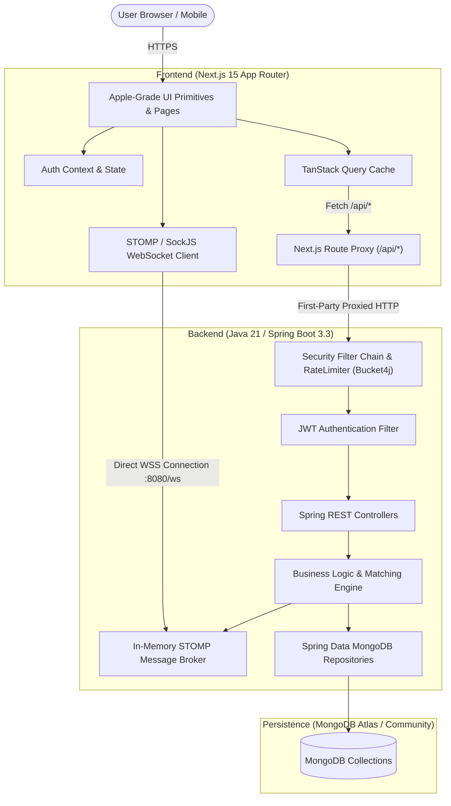
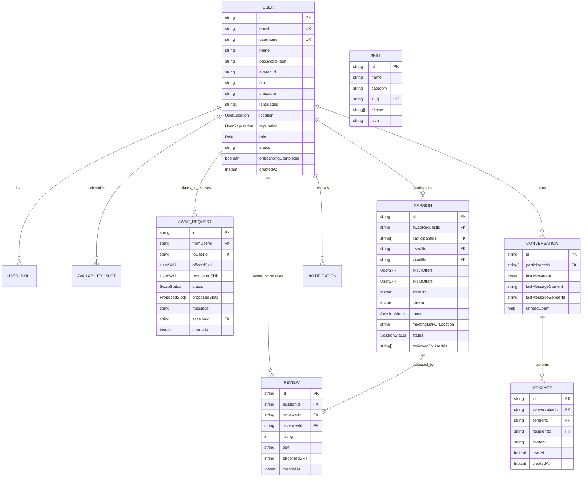

# SkillSwap System Architecture

SkillSwap is a peer-to-peer skill exchange platform where users teach skills they know and learn skills they want. Time and knowledge are the currency—no money changes hands.

---

## 1. High-Level Architecture

---

## 2. Component Layers

### 2.1 Frontend Architecture (Next.js 15 + TypeScript)
- **App Router**: Modern nested layouts, server components for static metadata, client components for rich interactivity.
- **Design System**: Apple-grade aesthetic using Tailwind CSS (`#FBFBFD` canvas, `#1D1D1F` text, `#0071E3` Apple Blue accent, hairline borders `rgba(0,0,0,0.08)`, true dark mode `#000000`/`#1C1C1E`).
- **State Management & Caching**: TanStack Query handles background revalidation, optimistic updates, and query deduplication.
- **Real-time Client**: STOMP over SockJS (`/ws`) subscribing to `/topic/conversation.{id}` and `/queue/notifications.{userId}`, backed by automatic reconnection and polling fallback.
- **Form Management**: React Hook Form combined with Zod schemas for client-side validation.
- **First-Party Cookie Proxy**: Next.js `rewrites()` proxies `/api/:path*` to the backend server, guaranteeing cookies remain strictly first-party across environments.

### 2.2 Backend Architecture (Java 21 + Spring Boot 3.3)
- **Layered Architecture**: Strict separation of concerns:
  `Filter -> Controller -> Service -> Repository -> MongoDB Document`.
- **Security & Token Rotation**:
  - Stateless JWT authentication via `httpOnly`, `SameSite=Lax` cookies.
  - Short-lived Access Token (15 minutes).
  - Long-lived Refresh Token (7 days) stored hashed in MongoDB with a TTL index and rotated on every exchange.
- **Rate Limiting (Bucket4j)**:
  - Token-bucket algorithm applied at servlet layer.
  - Auth endpoints limited to 20 attempts/min per IP.
  - Messaging POST endpoints limited to 60 messages/min per IP.
- **Error Standard**: RFC 7807 (`application/problem+json`) global handler emitting standardized `ProblemDetail` structures.

---

## 3. Data Model & MongoDB Schema Design

### Indexed Collections Summary
| Collection | Indexes | Purpose |
|------------|---------|---------|
| `users` | `email` (unique), `username` (unique), `[name, bio]` (text), `[role, status]` (compound) | Identity lookups, full-text discovery, admin filtering |
| `skills` | `slug` (unique), `category` | Taxonomy categorization & slug lookup |
| `swapRequests` | `[fromUserId, status]`, `[toUserId, status]` | Dashboard requests & outgoing proposal queries |
| `sessions` | `[participantIds, status]`, `[participantIds, startUtc]` | Conflict checking, upcoming agenda, session history |
| `conversations` | `[participantIds, lastMessageAt DESC]` | Inbox ordering |
| `messages` | `[conversationId, createdAt ASC]` | Paginated chat message retrieval |
| `reviews` | `[sessionId, reviewerId]` (unique), `[revieweeId, createdAt DESC]` | Duplicate review prevention, public profile ratings |
| `refreshTokens` | `tokenHash` (unique), `expiresAt` (TTL) | Token rotation & automatic MongoDB expiry deletion |

---

## 4. The Matching Engine

The core intelligence of SkillSwap resides in `MatchingService.java`. It evaluates potential swap partners against a multi-criteria scoring algorithm yielding a normalized score between **0 and 100**, paired with human-readable explanation badges (`reasons[]`).

### 4.1 Scoring Formula

$$S = S_{\text{mutual}} + S_{\text{level}} + S_{\text{avail}} + S_{\text{lang}} + S_{\text{mode}} + S_{\text{rep}}$$

$$\text{Final Score} = \min(100, \max(0, S))$$

### 4.2 Scoring Components

1. **Mutual Fit ($S_{\text{mutual}}$ - Up to 50 Points)**
   - *Direct 2-Way Match*: User A teaches what User B wants to learn, **and** User B teaches what User A wants to learn.
     $$\text{Mutual Match} \implies 50 \text{ pts}$$
   - *One-Way Complement*: User B teaches what User A wants, but no reciprocal need identified yet.
     $$\text{One-Way Match} \implies 20 \text{ pts}$$

2. **Level Compatibility ($S_{\text{level}}$ - Up to 15 Points)**
   - For matching skills, if teacher level is equal to or exceeds target learner level (e.g. Expert teaching Beginner/Intermediate):
     $$\Delta \ge 0 \implies 15 \text{ pts}$$
   - If teacher is at least Intermediate: $10 \text{ pts}$.

3. **Availability & Timezone Overlap ($S_{\text{avail}}$ - Up to 15 Points)**
   - **Weekly Day & Time-of-Day Overlap**: Overlapping slots (Morning, Afternoon, Evening) on common days of the week:
     $$\text{Slot Overlap} \implies \min(10, \text{matches} \times 3.5) \text{ pts}$$
   - **Timezone Closeness**: Based on timezone offset difference $\le 3$ hours: $5 \text{ pts}$.

4. **Language Overlap ($S_{\text{lang}}$ - Up to 10 Points)**
   - Common spoken languages between users:
     $$\text{Shared Languages} \implies \min(10, \text{common} \times 5) \text{ pts}$$

5. **Mode Alignment ($S_{\text{mode}}$ - Up to 5 Points)**
   - Both users accept `ONLINE` sessions or both share the same city for `IN_PERSON`:
     $$\text{Compatible Mode} \implies 5 \text{ pts}$$

6. **Reputation Boost ($S_{\text{rep}}$ - Up to 5 Points)**
   - Rating $\ge 4.8$: $5 \text{ pts}$
   - Rating $\ge 4.5$: $3 \text{ pts}$
   - Completed Sessions $\ge 5$: $+2 \text{ pts}$ (capped at 5 total)

### 4.3 Performance & Caching Strategy
- Match calculations are cached per user via Spring Cache:
  `@Cacheable(value = "matches", key = "#currentUser.id")`
- Caches are automatically invalidated whenever a user updates their profile, modifies taught/wanted skills, or adjusts their weekly availability.

---

## 5. Real-Time WebSocket & STOMP Protocol

SkillSwap implements an in-memory message broker with standard STOMP destinations:

- **Connection URL**: `/ws` (with SockJS fallback)
- **Client Subscribe Destinations**:
  - `/topic/conversation.{conversationId}`: Direct message dispatch for active chat room.
  - `/queue/notifications.{userId}`: Instant push alerts for new swap proposals, session acceptances, and reviews.
- **Client Send Destinations**:
  - `/app/chat.send`: Direct real-time message sending.
- **Graceful Fallback**: If WebSocket or STOMP handshakes fail (e.g. strict corporate firewalls or missing proxy headers), the frontend client seamlessly transitions to background HTTP polling every 4 seconds.
